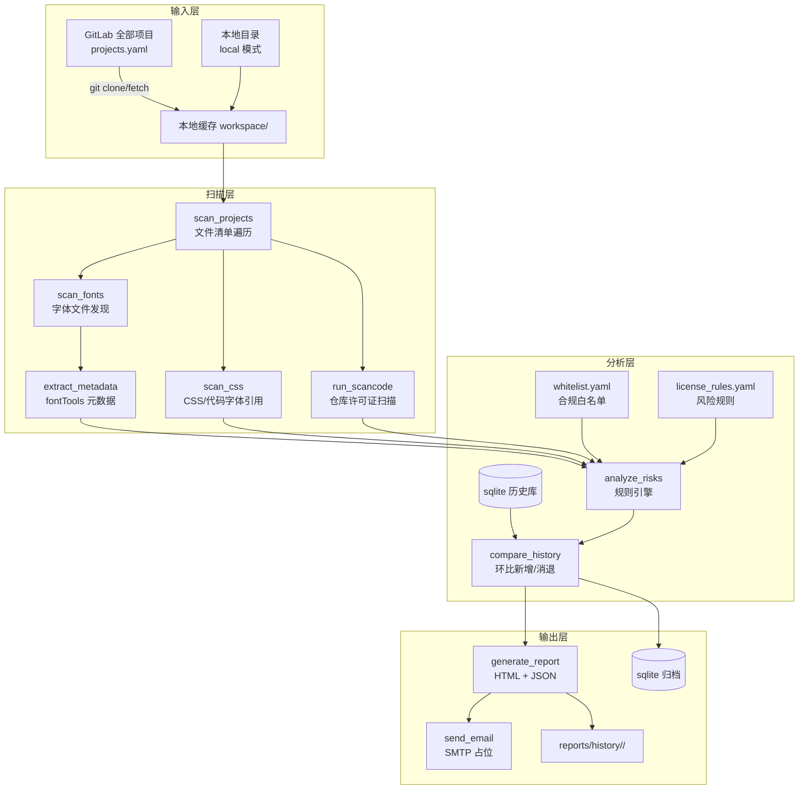

# 字体版权合规检测系统 · 实施方案（设计文档）

> 文档性质：落地思路与拆解依据，供分步实施使用。
> 版本：v1.3　|　状态：**工程结构化拆解依据（POC 验证完成 → 工程化启动）**　|　对应环境：`git=gitlab, runtime=linux, projects=all, mail=smtp, scope=both`
> **v1.3 决策（2026-11-09 确认）**：① POC→工程**迁移重建**，`poc/` 保留对照至工程验收后归档；② 交付形态**仅纯 Python 工程**（Docker/部署配置移二期）；③ 本 v1.3 任务拆解为**唯一依据**（吸收 §13/§14 评审与管理方案 §15）；④ 白名单 3 条已签署 **active**（"已确认允许"翻转已演示）。
> 已确认决策：① 手动执行（调度二期）② 检测范围 = 字体文件 + 仓库开源协议 ③ GitLab/SMTP 信息占位 ④ 扫描时间二期再定
> **v1.1 修订**：依据两仓库 POC 实测 + 评审反馈七类问题，修订风险规则模型（§6/§7），新增修订记录（§13）。

---

## 1. 背景与目标

对现有代码仓库中的所有项目，定期（当前手动、后续每周自动）扫描 **TTF/OTF/WOFF/WOFF2/EOT 等字体文件** 与 **仓库开源许可证**，提取许可证信息、匹配授权规则、标记风险，生成报告并通过邮件通知技术部负责人。

**核心边界（必须贯穿所有产出物）**：字体检测 ≠ 侵权判定。系统只负责 *识别 → 提取 → 匹配 → 标记风险*，最终侵权结论由技术部负责人审核确认。该声明固定出现在 HTML 报告页脚与邮件模板中。

### 建设要求对照表

| 项目 | 要求 | 本方案落点 |
|---|---|---|
| 检测范围 | 所有项目仓库 | `config/projects.yaml`（manual/local/auto 三模式） |
| 检测对象 | TTF/OTF/WOFF/WOFF2/EOT | `scan_fonts.py` + fontTools |
| 检测内容 | 字体名、版权、许可证、授权限制、来源 | `extract_metadata.py`（name 表 + OS/2 fsType） |
| 检测内容 | 仓库开源协议 | `run_scancode.py`（ScanCode Toolkit） |
| 检测频率 | 每周一次 | **二期**：crontab / GitLab CI Schedule；当前手动 |
| 风险处理 | 自动识别、分级、报告 | `analyze_risks.py` + `license_rules.yaml` |
| 通知方式 | SMTP 邮件，多收件人 | `send_email.py` + `email.yaml`（占位） |
| 历史记录 | 保存每次结果、支持追踪 | sqlite + `reports/history/<run_id>/` |

---

## 2. 总体架构与数据流



**单次执行流水线（main.py 编排，任一步失败不中断整体，记入运行日志）**：

```
git_sync → scan_projects → scan_fonts → extract_metadata
         → scan_css → run_scancode(可选) → analyze_risks
         → compare_history → generate_report → [send_email(二期/占位)]
```

---

## 3. 技术选型（方案 A 轻量化开源组合）

| 建设项 | 选型 | 选型理由 / 关键事实 |
|---|---|---|
| 字体扫描 | **Python 3.11+ / fontTools + brotli** | fontTools 是字体处理事实标准（MIT 协议）；直接读 OpenType `name` 表 ID 0/1/4/13/14 与 `OS/2.fsType`；brotli 用于 WOFF2 解压 |
| 许可证扫描 | **ScanCode Toolkit**（约 2400+ 许可证库） | 正文级匹配而非正则近似，输出 JSON；含版权语句文法解析；作为**可选组件**集成，未安装时自动跳过 |
| CSS 引用识别 | 自研 Python 扫描器 | 识别 `@font-face`、`font-family`、`url()`、Google Fonts 等 CDN 引用 |
| 风险分析 | 自研 YAML 规则引擎 | 规则外置可调，无需改代码 |
| 白名单 | YAML | 按 `字体名 + 许可证 + 来源` 匹配，支持 sha256 精确豁免 |
| 调度 | **二期**：Linux crontab + Docker（或 GitLab CI Schedule） | 一期手动执行 |
| 报告 | HTML（Jinja2）+ JSON | 人读 + 机读双份 |
| 邮件 | smtplib + TLS | 支持多收件人，占位配置 |
| 历史 | JSON 归档 + sqlite 索引 | 支持风险项环比对比 |

> 补充参考：社区亦有 `fontmeta`（字体许可证元数据读取/校验）等同类工具，思路可借鉴，本方案以 fontTools 自研提取为主，避免额外依赖。

---

## 4. 目录结构

```
font2trust/
├── config/
│   ├── scanner.yaml        # 全局配置(路径/扩展名/排除/scancode/历史)  ✅已建
│   ├── projects.yaml       # 仓库清单: manual/local/auto 三模式        ✅已建
│   ├── whitelist.yaml      # 合规字体白名单                            ⬜ 待建
│   ├── license_rules.yaml  # 许可证→风险等级规则                       ⬜ 待建
│   └── email.yaml          # SMTP 与收件人(占位)                       ⬜ 待建
├── scripts/
│   ├── main.py             # 编排入口 + CLI
│   ├── utils.py            # 配置加载(支持 ${ENV:-默认值})/日志/哈希
│   ├── git_sync.py         # 仓库同步(clone/fetch, token 走环境变量)
│   ├── scan_projects.py    # 项目文件清单遍历(排除规则)
│   ├── scan_fonts.py       # 字体文件发现
│   ├── extract_metadata.py # 字体元数据提取(fontTools)
│   ├── scan_css.py         # CSS/代码字体引用识别
│   ├── run_scancode.py     # ScanCode 封装(可选, 缺失则跳过)
│   ├── analyze_risks.py    # 风险分析与分级
│   ├── compare_history.py  # 历史对比(新增/消退/持续)
│   ├── db.py               # sqlite 读写
│   ├── generate_report.py  # HTML + JSON 报告
│   └── send_email.py       # SMTP 邮件(占位)
├── reports/
│   ├── current/            # 最新一次: report.html / report.json / run.log
│   └── history/            # 按 run_id 归档 + scanner.db
├── templates/
│   ├── report.html         # Jinja2 报告模板
│   └── email_template.html # 邮件模板(含免责声明)
├── tests/
│   ├── make_fixture_fonts.py  # 生成样例字体(或复制系统字体)
│   └── smoke_test.py          # 端到端冒烟
├── deploy/
│   ├── run_weekly.sh       # 二期: 容器执行入口(含 flock 防重入)
│   └── crontab.example     # 二期: 每周一 09:00 示例
├── workspace/              # 仓库本地缓存(gitignore)
├── requirements.txt        # fonttools / brotli / PyYAML / Jinja2
├── Dockerfile
├── docker-compose.yml
└── README.md
```

---

## 5. 模块设计（拆解单元）

每个模块统一约定：**函数式接口 + 输入输出均为 dict/list（JSON 可序列化）**，便于单测与逐个落地。

| # | 模块 | 职责 | 输入 | 输出 | 关键点 |
|---|---|---|---|---|---|
| 1 | `utils.py` | 配置加载、日志、sha256 | YAML 路径 | dict | 支持 `${ENV:-默认值}` 插值，敏感项不落盘 |
| 2 | `git_sync.py` | 仓库同步 | projects.yaml | `[{name,url,path,ok,error}]` | manual: clone→fetch+checkout；local: 校验存在；auto: GitLab API（占位）；失败但本地已有缓存则降级继续 |
| 3 | `scan_projects.py` | 文件清单 | workspace 路径 | `[{project,path,size,ext}]` | 排除 `.git/__pycache__` 等；`scan_dependencies=false` 时排除 `node_modules/vendor/dist/build` |
| 4 | `scan_fonts.py` | 字体发现 | 文件清单 | `[{project,path,ext,size,sha256}]` | 按扩展名过滤；TTC 取 fontNumber=0 |
| 5 | `extract_metadata.py` | 元数据提取 | 字体记录 | 增补字段（见 §6.1） | fontTools 解析；解析失败 → `parse_error` 标记（EOT 不可解析 → 待人工确认） |
| 6 | `scan_css.py` | 引用识别 | 文件清单 | `[{project,file,line,kind,value,local_path,exists}]` | 正则覆盖 `@font-face`/`font-family`/`url()`/CDN；与字体清单关联 |
| 7 | `run_scancode.py` | 仓库许可证 | 仓库路径 | `[{project,licenses[],copyrights[]}]` | `scancode -clipeu --json-pp`；找不到可执行文件 → `skipped` 不报错 |
| 8 | `analyze_risks.py` | 风险引擎 | 上述全部 + 两份 YAML | findings（见 §6.2） | 命中规则记录 `rules_hit`，给出 `suggestion` |
| 9 | `compare_history.py` | 环比 | 本次 findings + sqlite | `added/resolved/unchanged` | 以 finding id（文件 sha256 前缀）为键 |
| 10 | `generate_report.py` | 报告 | findings + stats | report.html / report.json | 分级着色、仓库协议表、免责声明 |
| 11 | `send_email.py` | 邮件 | report + email.yaml | SMTP 发送 / 跳过日志 | `enabled:false` 或占位值时只渲染 `email_preview.html` |
| 12 | `main.py` | 编排 | CLI 参数 | 退出码 | `--skip-scancode / --no-email / --projects <文件>`；每步计时写 run.log |

---

## 6. 数据模型

### 6.1 字体元数据（extract_metadata 输出字段）

| 字段 | 来源 | 说明 |
|---|---|---|
| `family / subfamily / full_name / ps_name / version` | name ID 1/2/4/6/5 | 字体身份 |
| `copyright` | name ID 0 | 版权声明 |
| `license_text` | name ID 13 | 许可证全文（关键判定依据） |
| `license_url` | name ID 14 | 许可证链接 |
| `trademark / manufacturer / designer / vendor_url` | ID 7/8/9/11 | 来源线索 |
| `fs_type / embedding` | OS/2 表 | 位掩码解码：禁止嵌入/预览打印/可编辑等 |
| `sha256` | 文件哈希 | 白名单精确豁免与历史对比主键 |

### 6.2 风险记录（finding，v1.1 修订：字体系列为统计主体，三维度分离）

**三维度模型**（v1.1 核心变更，杜绝"证据缺失 = 高危"的误判）：

| 维度 | 字段 | 说明 |
|---|---|---|
| 证据 | `evidence[]` | 客观观察：元数据为空 / fsType 位 / 词库命中 / ScanCode 匹配 / 来源组件推导 |
| 等级 | `risk_level` | 由证据+上下文综合评级（规则见 §7），仅特定证据组合才判 high |
| 状态 | `status` | 工作流：待处理 / 待评估 / 待确认 / 已核实 / 仅记录 |

```json
{
  "type": "font_series | css_ref | repo_component",
  "family": "GLYPHICONS Halflings Regular",     // 统计主体(风险按系列计)
  "font_version": "Version 1.10",               // name ID 5
  "source_package": "bootstrap",                // 路径推导(bower_components/<pkg>)
  "source_version": null,                       // 组件清单缺失时报"未记录", 不猜测
  "source_url": null,
  "license_status": "缺失(来源明确)",            // 版权维度, 与 parse_status 分离
  "license_spdx": "OFL-1.1",                    // 标准化
  "license_expression": "ofl-1.1 AND mit",      // ScanCode 按文件路径合并(交叉验证)
  "license_files": ["bower_components/x/LICENSE"],
  "evidence": ["name表许可证字段为空", "fsType=预览打印(0x0004)..."],
  "risk_level": "high | medium | review | low | info",
  "status": "待处理 | 待评估 | 待确认 | 已核实 | 仅记录",
  "rules_hit": ["meta_license_missing", "fs_embed_preview_print"],
  "suggestion": "…",
  "files": [                                    // 整改对象(第二级)
    {"path": "…", "ext": ".ttf", "sha256": "…",
     "locations": ["…ttf", "…/其他模块/同文件"],   // sha256 跨目录去重
     "parse_status": "ok | unsupported_eot",     // 技术维度, 不产生版权结论
     "fs_type": 4, "referenced": true}
  ]
}
```

`parse_status`（技术）与 `license_status`（版权）**彻底分列**：EOT 等不支持格式只记技术状态，版权判定按"同系列其他格式 + 组件 LICENSE + 来源"关联推定（§13-R4）。

### 6.3 历史记录（v1.3 修订：文件归档，撤销 sqlite）

> **决策（2026-11-09）**：不持久化数据库。每次运行将全部产物归档至
> `reports/history/<run_id>/`（report.html / report.json / 台账 / summary 等），
> 按 `history.keep_runs` 保留最近 N 批次自动清理。

| 项 | 设计 |
|---|---|
| run_id | 时间戳 `YYYYMMDD-HHMMSS`（目录名，天然可排序） |
| 归档内容 | 当次 `reports/current/` 全量产物（大文件不进库） |
| 保留策略 | `scanner.yaml history.keep_runs: 52`（约一年），超期自动删除 |
| 审计 | 白名单变更走 git（config/whitelist.yaml 版本管理）；批次回溯靠归档文件 |
| （原）sqlite | **已撤销**：runs/findings 两表设计废弃，见 §10 T8 决策 |

---

## 7. 风险分级规则（license_rules.yaml 设计，v1.1 修订为五档条件表）

**核心原则：高等级必须有直接证据**（明确禁止商用条款 / 授权范围不符 / 来源不明且无法提供授权证明），
"元数据缺失"本身只产生待确认，不产生高危。

| 检测条件 | 等级 | 处置状态 | 处理方式 |
|---|---|---|---|
| 许可证字段为空（来源组件可推导） | ⚪ review 待确认 | 待确认 | 查找组件 LICENSE 文件及来源，补授权依据 |
| fsType=0（无嵌入限制） | 🔵 info 信息 | 仅记录 | 不作为版权风险证据 |
| fsType=4 / 0x0002（嵌入限制） | 🟡 medium 待评估 | 待评估 | 核实实际使用方式及授权范围（web 加载属嵌入行为） |
| 存在明确许可证及授权来源（name 表 / ScanCode / 组件 LICENSE / 白名单） | 🟢 low 已核实 | 已核实 | 记录许可证与来源，归档备案 |
| 限制性条款（GPL/AGPL/CC-NC） | 🟡 medium 待评估 | 待评估 | 结合分发方式、链接方式评估，不凭名称判违规 |
| 疑似商用词库命中 且 无授权依据 | 🔴 high 待处理 | 待处理 | 暂停发布或替换，核查商业授权合同 |
| 来源不明 且 无法提供授权依据 | 🔴 high 待处理 | 待处理 | 暂停发布或替换，追溯来源 |
| 格式不支持解析（EOT 等） | ⚪ review 待确认 | 待确认 | **不判版权风险**，按同系列格式/组件 LICENSE 关联推定 |

规则实现要点：
- **词库透明化**：商用词库条数与命中关键词在报告中展示（`commercial_keywords` 外置 YAML）；
- **双引擎交叉验证**：name 表元数据 与 ScanCode 正文匹配 按文件路径合并，任一命中即构成授权依据；
- **规则加载归一化**：清洗正则空分支（POC 实测教训：末尾 `|` 导致全量误报）+ 规则单测；
- **统计口径三级**：字体系列数（风险主体）/ 文件数（整改对象）/ 组件数（来源），同系列不同格式不重复计数。

规则文件结构（示意）：

```yaml
rules:
  - id: commercial_font
    level: high
    match: { font_family_regex: "方正|汉仪|华文|微软雅黑|Adobe|Helvetica|Arial" }
    suggestion: "疑似商业字体, 请核查商业授权合同"
  - id: open_license
    level: low
    match: { license_text_regex: "SIL Open Font License|Apache License, Version 2.0|MIT License" }
whitelist_ref: config/whitelist.yaml
```

白名单结构（示意）：

```yaml
entries:
  - { font_family: "Noto Sans SC", license: "OFL-1.1", source: "google/fonts", note: "集团采购备案 2026-001" }
  - { sha256: "ab12...", note: "商业授权合同 #F-2026-008" }
```

---

## 8. 配置设计（敏感信息原则）

- `config/scanner.yaml`、`config/projects.yaml` **已建**，作为 schema 示例（值为占位）。
- `${ENV_NAME}` / `${ENV_NAME:-默认值}` 插值由 `utils.py` 实现。
- 凭据只走环境变量：`GITLAB_TOKEN`、`SMTP_PASSWORD`，**不写入任何 YAML/代码/日志**。
- `email.yaml` 结构：

```yaml
enabled: false            # 占位期为 false, 只渲染不发送
host: smtp.example.com    # TODO 后续提供
port: 465
use_ssl: true
username: scanner@example.com
password_env: SMTP_PASSWORD
from: font-scanner@example.com
recipients:               # 多收件人, 后续配置
  - tech-lead@example.com
cc: []
only_on_risk: false       # true=仅高/中风险才发信
```

---

## 9. 执行方式

### 一期（当前）：手动执行

```bash
# 本机
python scripts/main.py                        # 全流程
python scripts/main.py --skip-scancode        # 跳过许可证扫描(未安装 scancode 时)
python scripts/main.py --projects config/projects.yaml --no-email

# Docker
docker compose run --rm scanner python scripts/main.py
```

产物：`reports/current/report.html`（人读）、`report.json`（机读）、`run.log`；归档 `reports/history/<run_id>/`。

### 二期（调度，待设计）

- 方案 A（推荐）：Linux 主机 `0 9 * * 1 /opt/font2trust/deploy/run_weekly.sh`（flock 防重入）
- 方案 B：GitLab CI Schedule（weekly pipeline，产物走 Artifacts）
- 二者均需先接入真实 GitLab 与 SMTP。

---

## 10. 分期实施计划（供拆解）

### 一期 · 工程结构化（迁移重建，POC 保留对照）

> 以下 T1–T11 已吸收 POC 全部已验证能力（四维度状态、四结论、白名单消费、台账、
> 证据目录、五分类、组件评估、五区块报告），验收数据基准见 `docs/验收对照-20261109.md`。

| 任务 | 内容 | 验收标准（对齐 POC 实测基线） |
|---|---|---|
| T1 骨架 | 按 §4 正式结构重建 `config/ scripts/ templates/ tests/`；从 POC **迁移逻辑**（不背债务）；requirements 锁版本 | 配置加载与全模块导入通过；`poc/` 原样保留对照 |
| T2 字体扫描 | `scan_projects` / `scan_fonts` / `extract_metadata`（fsType 解码、parse_status 技术维度） | 后端仓库输出 24 文件/12 去重元数据，与 POC 一致 |
| T3 CSS 引用 | `scan_css` 块级解析（注释剥离、@font-face src 全列表、URL 分类、版本提示、证据链关联） | 48 条引用与 POC 一致；资产与名称引用两类分开 |
| T4 许可证扫描 | `run_scancode`（可选组件，缺失 skipped 不中断）+ 逐文件表达式 | 全量/复用两模式均可；输出组件级与文件级表达式 |
| T5 风险与结论引擎 | `analyze_risks`：四维度状态 + 四结论 + 五档规则 + **白名单消费（active 唯一入口）** + 组件评估（识别≠核实）+ 自有代码五分类 | 白名单 3 active → `已确认允许 3`；规则单测含正则空分支回归用例 |
| T6 台账与证据 | 字体授权台账（15 字段）+ `font-compliance/` 证据目录生成 + `license_sources/` 原文归档 | 台账 3 系列 + 文件明细；证据目录 12 文件与 POC 一致；缺失时如实记"证据未找到" |
| T7 报告 | `generate_report` 五区块 HTML（01 总览 / 02 授权结论 / 03 证据详情 / 04 整改清单 / 05 CSS 链）+ JSON | 结构与数据对齐 §15；免责声明固定在位 |
| T8 | 历史归档 | `history.py`：每次运行产物复制到 `reports/history/<run_id>/`，按 `keep_runs` 自动清理；**不做 sqlite 持久化（2026-11-09 决策撤销原 db 设计）** | 每次运行生成独立历史目录；旧批次按保留策略清理；原始文件可回溯 |
| T9 邮件占位 | `send_email` + `email.yaml`（enabled=false） | 仅渲染 `email_preview.html`，不联网 |
| T10 部署与文档 | README（占位项清单/免责声明/验收对照）+ 纯 Python 运行说明 | 单命令端到端执行成功（Docker 移二期） |
| T11 冒烟测试 | `tests/`：端到端 + 规则回归 + **白名单翻转用例**（active↔pending 结论变化） | smoke 全绿；翻转用例结论切换正确 |

### 二期 · 自动化与接入

| 任务 | 内容 |
|---|---|
| P0 | Docker 化与 Linux 环境实测（Dockerfile/compose 已按决策移至此处） |
| P1 | GitLab 真实接入（URL/token 注入，auto 模式全量发现） |
| P2 | SMTP 真实接入 + 收件人确认 + 发送策略（仅风险触发/每次都发） |
| P3 | 定时调度（crontab 或 GitLab CI Schedule，含日志与失败告警） |
| P4 | 白名单与商业字体词库持续运营、阈值调优 |
| P5 | 历史趋势报表（周环比/月趋势）、风险闭环状态字段（待处理/已确认/已整改）、整改责任人对接工单 |

---

## 11. 待补充信息清单（占位项）

| # | 事项 | 占位方式 | 提供时机 |
|---|---|---|---|
| 1 | GitLab 地址 + 只读 token | `GITLAB_URL`/`GITLAB_TOKEN` 环境变量 | 二期接入前 |
| 2 | 项目清单（或 group） | `projects.yaml` 占位，`enabled:false` | 同上 |
| 3 | SMTP 服务器/账号/密码 | `email.yaml` + `SMTP_PASSWORD`，`enabled:false` | 二期接入前 |
| 4 | 收件人（技术部负责人，支持多人） | `recipients` 列表占位 | 发信前 |
| 5 | 扫描时间 | 一期不设定；二期设计 | 二期 |
| 6 | 白名单初版 + 商业字体词库 | `whitelist.yaml`/`license_rules.yaml` 初始规则 | T5 前后可迭代 |

---

## 12. 已知限制与风险（写入 README）

1. **检测 ≠ 侵权**：系统输出为风险提示，结论需人工审核。
2. **EOT 无法解析**元数据 → 固定归入 `review`（待人工确认），不误判等级。
3. **WOFF XML 元数据块**（name 表之外的补充许可证信息）一期不解析，作为已知缺口。
4. **依赖目录**（node_modules 等）默认不扫，可能漏掉随包分发的第三方字体 —— 如需覆盖改 `scan_dependencies: true`，注意噪音与耗时。
5. **无许可证元数据 ≠ 侵权**：很多字体不填 nameID13，需结合来源与白名单人工确认。
6. ScanCode 为重型组件，镜像体积增大；`Dockerfile` 用 `WITH_SCANCODE=0/1` 构建参数控制。

---

## 13. POC 评审修订记录（v1.1）

> 来源：两真实仓库（前端 huier-admin-web / 后端 huier-manage-cloud）POC 扫描结果评审。
> POC 结论：**技术链路可行**；风险判定规则不成熟，按下表修订（已同步至 §6/§7 与 POC 代码）。

| # | 评审问题 | 修订落点 | POC 实测验证 |
|---|---|---|---|
| R1 | `missing_license → high` 把证据缺失当风险等级 | §7 五档条件表；三维度模型（证据/等级/状态） | 后端高危 10 → **0**；glyphicons 改判 medium(待评估)、ionicons → review(待确认) |
| R2 | 缺版本/来源/追溯字段 | §6.2 新增 8 字段（font_version/sha256/source_package/version/url/license_expression/license_file/license_status） | 组件无清单时如实报"版本未记录"，不猜测 |
| R3 | 同字体多格式重复计数 | 两级统计：系列(主体)→文件(对象)；sha256 跨目录去重 | 24 文件 → 3 系列 / 12 去重文件；两 xxl 模块相同文件合并展示多位置 |
| R4 | EOT 解析失败与版权风险混淆 | `parse_status` 与 `license_status` 分列；同系列格式关联推定 | EOT 并入同系列组，判定继承可解析格式证据，不再独立计风险 |
| R5 | CSS 行级解析误判（压缩 CSS、注释 URL、src 只取首个） | 块级解析：注释剥离 + @font-face 块提取 src 全列表 + 仅字体资源 URL 计入 | `sans-serif` 误标 @font-face、`fontawesome.io` 误标 CDN 两类误判消除 |
| R6 | 无 LICENSE ≠ 违规；聚合表达式 ≠ 仓库许可证 | 自有/第三方分栏；lockfile 排除；按文件/组件记录；GPL 不凭名称判违规 | 自有代码标"未声明(内部项目正常)"；第三方 22 组件独立记录 |
| R7 | 报告统计与交互缺陷 | 覆盖率区块、卡片/按钮筛选联动、商用词库透明化、空态提示、系列/文件双口径 | 报告含覆盖率表（frontend 563 文件/0 字体 = 已扫描无发现） |

**POC 期间发现并修复的代码缺陷**（并入 T10 冒烟用例）：
1. 规则正则末尾 `|` 空分支 → 全量误报（已加 normalize_regex 归一化）；
2. ScanCode 输出目录未先创建 → `--json-pp` 失败；
3. `external` 为常见 Java 包名段 → 自有代码误判第三方（已排除 src/main|test/java 路径）；
4. font-family 声明"关联缺失"误判为待评估（仅本地字体文件缺失才计风险）。

---

## 14. POC v2.1 整改记录（评审任务 10/10 闭环）

> 评审结论采纳：v2 核心新问题是"**把许可证识别结果过早升级成许可证已核实**"。
> 架构不推翻 v2，升级为 v2.1；采用**方案B**（字体风险与第三方组件统计分离）。

### 14.1 四维度状态模型（评审§四落地）

| 维度 | 取值 | 说明 |
|---|---|---|
| 风险等级 `risk_level` | 高危 / 中危 / 低危 / 信息 | 仅四档，不含"待确认" |
| 审核状态 `review_status` | 待确认 / 待评估 / 已核实 / 已整改 / — | 工作流；**已核实仅由白名单/人工确认产生** |
| 技术状态 `tech_status` | 正常 / 部分不支持 / 不支持 / 未引用 | 与版权完全分离 |
| 许可证状态 `license_status` | 已识别 / 证据待补 / 已核实 / 存在冲突 / 未知 | 证据充分性；识别 ≠ 核实 |

**已核实的证据门槛**（六项齐全才可标）：组件名称 + 准确版本 + 来源 + 许可证原文 + 适用文件范围 + 条件核对结果。
POC 自动化最多达到"证据待补"，"已核实"保留给白名单/人工审核。

### 14.2 整改任务闭环（10/10）

| 级别 | 任务 | 实现 | 实测验证 |
|---|---|---|---|
| P0 | FontAwesome 低危·已核实 → 证据待补 | 无原文归档/范围核对不得标已核实；仅 URL 明示为"线索" | FontAwesome: `low/待确认/证据待补`，建议"补齐原文归档后再申请已核实" |
| P0 | Ionicons 字体与组件状态冲突 | 组件许可证**不继承**给字体（`component_license_not_inherited` 证据） | 字体 `中危/待确认/未知` vs 组件 `低危/待确认/已识别`，附不继承说明 |
| P0 | 组件低危判定证据门槛 | `assess_component()`：unknown→存在冲突、OR 未选择→存在冲突、无原文最高到已识别 | fastclick(unknown)→中危/存在冲突；jquery-slimscroll(OR)→中危/存在冲突；PACE/moment→中危/未知；22 实例全部"待确认"，0 已核实 |
| P0 | 顶部统计与筛选不一致 | **方案B**：卡片仅统计字体系列+CSS；组件区独立统计条+独立筛选 | 卡片 `0/2/1/48` 只含字体；组件条 `实例22/唯一11/重复32` 独立核算 |
| P1 | Glyphicons fsType 描述 | 按模板：技术说明/风险结论/处理建议三段式 + 组件许可证不覆盖字体提示 | 证据含"当前证据不足以认定侵权，也不足以确认所有使用场景均符合授权" |
| P1 | FontAwesome 版本冲突 | `_major()` 比对字体版本与 CSS 版本提示 → `version_mismatch` 技术告警 | 告警命中：CSS「Font Awesome 5 Free」vs 字体「Version 4.7.0 2016」，明示非版权违规 |
| P1 | 自有代码分类 | 五分类：自有/第三方组件/Vendor/自动生成(文件头启发式)/来源待确认(copyleft 检出) | 自有4223 / 第三方64 / 待确认4（xxl-job 的 pom/README 检出 GPL 组合，列示待回溯） |
| P1 | 组件重复统计 | 三口径：唯一组件(名称+许可证主体去重) / 实例(目录) / 重复文件(sha256) | 11 唯一 / 22 实例 / 32 重复文件 |
| P2 | 商用词库降级 | 改名"商业字体名称线索"，**不参与定级**，报告声明"不代表授权状态或侵权结论" | 词库27条、命中0；仅作 evidence 展示 |
| P2 | CSS 证据追溯 | `linked_series` 链：CSS → @font-face → 字体文件 → 字体系列 → 许可证状态 | `@font-face 'Glyphicons Halflings' → GLYPHICONS Halflings Regular` |

### 14.3 验收对照（评审意见）

- 字体发现及归并 / 技术解析 / CSS 引用分析：**保持通过**
- 许可证识别：通过；**许可证证据核实：按证据门槛重构后待人工环节补全**（已核实仅白名单可达）
- 风险分级：四维度分离后修正；统计与交互：方案B 分离后修正
- **正式合规结论：仍需负责人人工审核环节（POC 定位为内部测试报告，转正式标准需接入白名单与审核工作流）**

---

## 15. 字体合规管理方案（v1.3 入档 · POC 已验证）

### 15.1 目标：每种字体回答四个问题

| # | 问题 | 数据落点 |
|---|---|---|
| 1 | 用了什么字体？ | 名称/版本/文件位置/SHA256/CSS 引用位置（台账 + font-files.txt） |
| 2 | 是否允许使用？依据是什么？ | 许可证原文/官方发行说明/哈希比对（LICENSE.txt + source-info.txt + 核实报告） |
| 3 | 判断到什么程度？ | **授权结论四类** + 风险等级 + 审核状态（多维并列） |
| 4 | 有问题怎么改？ | **整改方式五类** + 整改清单（原因/方式/文件/责任人/期限/复查） |

**核心原则**：扫描工具负责发现和收集证据，**不替代授权判断**——字体名称、许可证关键词、
fsType 均不得直接推导"允许商用/禁止使用"。

### 15.2 授权结论（四类，独立于风险等级）

| 结论 | 含义 | 产生方式 |
|---|---|---|
| 已确认允许（绿） | 证据齐全且核实满足许可条件 | **仅**白名单 `active`（人工签署） |
| 已确认不允许（红） | 明确违反许可证且无例外依据 | 需人工判定，扫描器不自动产生 |
| 授权待确认（黄） | 有字体但证据不足 | 扫描器证据性判断 |
| 技术无法判断（灰） | 不可解析/版本不可识别/链路不完整 | 扫描器标记，需人工补技术信息 |

**使用状态**（与结论独立）：正在使用 / 存在引用但未确认运行时使用 / 未发现引用 / 已移除 / 已替换。

### 15.3 字体授权台账与证据目录

- 台账 15 字段（名称/版本/位置/格式/SHA256/引用/来源/许可证/原文/适用对象/允许方式/使用限制/结论/使用状态/审核签署）→ `字体授权台账.md`
- 每字体证据目录（**找不到就记"证据未找到"，绝不补写许可证**）：

```
font-compliance/<字体>/
├── font-files.txt      # 文件清单(路径/格式/哈希/引用状态)
├── source-info.txt     # 来源(组件/上游标签/哈希比对结论)
├── LICENSE.txt         # 许可证原文或官方声明(含出处)
└── review-record.md    # 核实记录(方法/结论/条件/签署栏)
```

### 15.4 整改方式五类（含完成标准）

| 情况 | 处理 | 完成标准 |
|---|---|---|
| 已确认允许 | 保留 + 补许可证与版权声明 | 证据归档、条件满足 |
| 已确认不允许 | 删除或替换 | 仓库与部署产物不再包含 |
| 找不到许可证 | 追溯上游版本/合同，或替换 | 找到可靠依据或完成替换 |
| 未被实际使用 | 检查引用后清理 | 删除无用字体及引用 |
| 技术无法判断 | 补解析/人工检查 | 完成身份与使用关系确认 |

原则：**不因许可证缺失立即删除**——先判断是否真用、能否追溯、有无采购记录；确无法证明授权且无保留必要时，替换更易管理。

### 15.5 报告五区块（已实现）

01 字体使用总览（资产 vs 名称引用分开）→ 02 字体授权结论（四结论数量+明细）→
03 授权证据详情（原文/来源/版本/适用文件/授权范围/审核记录）→ 04 问题整改清单 →
05 CSS 引用与部署关系（证据链+部署待确认）；附加 06 组件合规、07 名称线索。

### 15.6 验收标准（九条）

见 `docs/验收对照-20261109.md`（POC 阶段实测：5✅ / 2⚠️ / 1 N/A / 1❌→T8 补齐）。
合格报告不等于全绿，而是**每种字体都有明确的处理结论与可追溯证据**。

---

## 附：配置文件现状

- `config/scanner.yaml` ✅ 已建（全局配置 schema 示例）
- `config/projects.yaml` ✅ 已建（三模式仓库清单示例）
- 其余 `whitelist.yaml` / `license_rules.yaml` / `email.yaml`：按 §7/§8 结构在 T5/T7 落地
